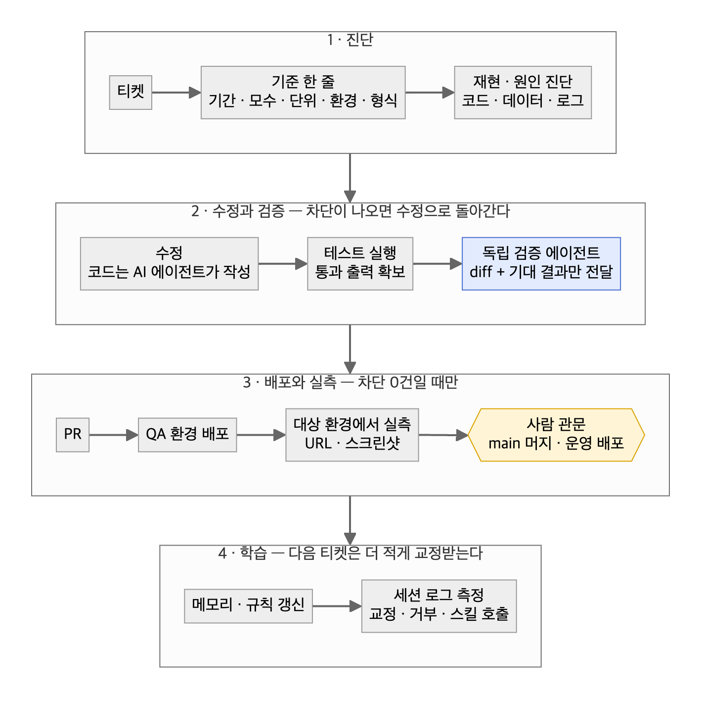
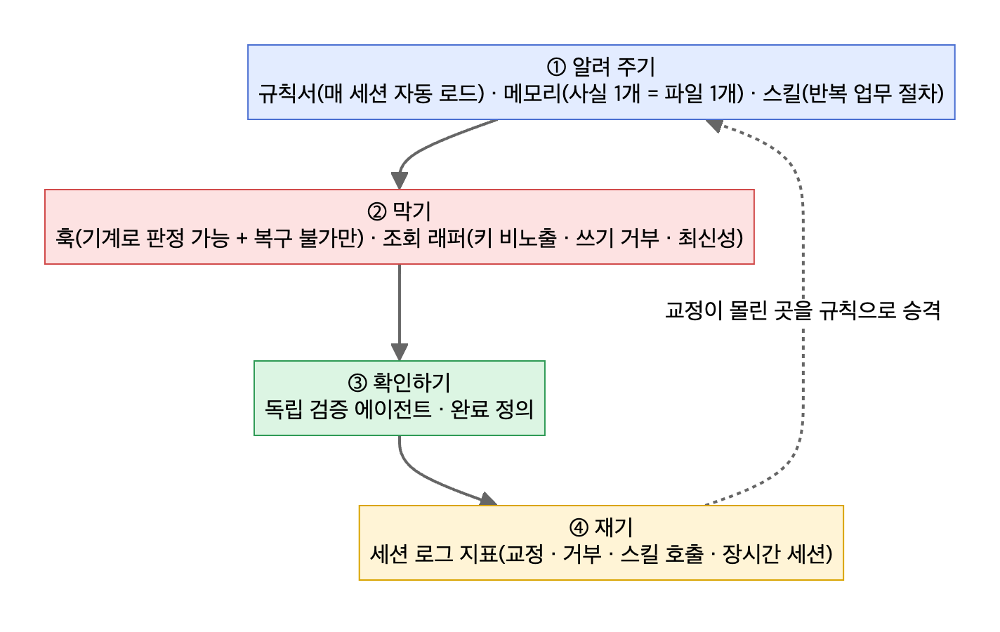

# 01. AI 에이전트 QA 워크플로

> 코드는 AI 에이전트가 쓰고, **원인 진단·검증·배포 확인은 사람이 책임진다.** 그 경계를 구조로 고정한 흐름이다.



## 하네스 4층 — 에이전트가 같은 실수를 반복하지 않게



| 층 | 무엇을 | 기준 |
|---|---|---|
| 알려 주기 | 규칙서·메모리·스킬 | 같은 교정이 3번 나오면 규칙서로 승격 |
| 막기 | 훅·조회 래퍼 | 훅은 **기계로 판정 가능 + 위반 시 복구 불가** 둘 다일 때만 |
| 확인하기 | 독립 검증 에이전트·완료 정의 | 검증자에게는 구현자의 설명·결론을 주지 않는다 |
| 재기 | 세션 로그 지표 | 개선 전후를 같은 스크립트·같은 옵션으로 잰다 |

## 템플릿 — 작업 시작 첫 줄

```
기준: 기간(시간대 명시) / 모수 / 집계 단위(누적·월별·단월) / 화면·환경 / 산출 형식
```
묻지 않고 가정을 먼저 보여 준다. 틀리면 그 줄에서 바로 잡힌다. (실제 교정의 대부분이 "누적 말고 월별", "메인 말고 베스트" 같은 기준 오해였다.)

## 템플릿 — 독립 검증 요청

```
레포: <경로>
범위: <base>..<head>  (또는 PR 번호)
기대 결과: <티켓의 기대 결과 문장 그대로>
— 구현자의 설명·테스트 결과는 넘기지 않는다
— 경계값·회귀 경로·호출하는 쪽의 계약 불일치를 반례로 찾는다
— 출력: 차단 / 경고 / 참고, 근거는 파일:줄
```

## 완료 정의

| 작업 | 완료 조건 |
|---|---|
| 코드 수정 | 테스트 통과 출력 → 독립 검증 차단 0건 → PR → 요청 환경 배포 → **그 환경에서 확인한 URL·스크린샷** |
| QA 검증 | TC 실행 결과(통과·실패·차단 건수) → 결함은 티켓 번호로 → 결과 코멘트 |
| 원인 분석 | 재현 조건 → 근본 원인 → 증거 → 영향 범위 → 조치안, **추정과 실측 구분** |
| 데이터·지표 | 쿼리 원문 + 데이터소스 + 기준 시각 + 표본 크기 |

## 체크리스트
- [ ] 첫 줄에 기준을 적었다
- [ ] 수정 전에 재현했다 (재현 못 하면 "미재현"으로 보고)
- [ ] 테스트 통과 **출력**을 확보했다 (mock만 통과는 미완료)
- [ ] 검증자에게 diff와 기대 결과만 줬다
- [ ] 대상 환경 도메인에서 변경을 눈으로 확인했다
- [ ] main 머지·운영 배포는 사람 관문으로 남겼다
- [ ] 같은 함정이 반복되면 메모리 → 규칙서로 올렸다

근거 사례: [사례 08 — AI 코딩 에이전트로 QA 업무 재설계](../2-career-flow/cases/08-ai-agent-qa-workflow.md) · 설치 가능한 템플릿: [이식 가이드](../1-ai-workflow-guide/README.md)
