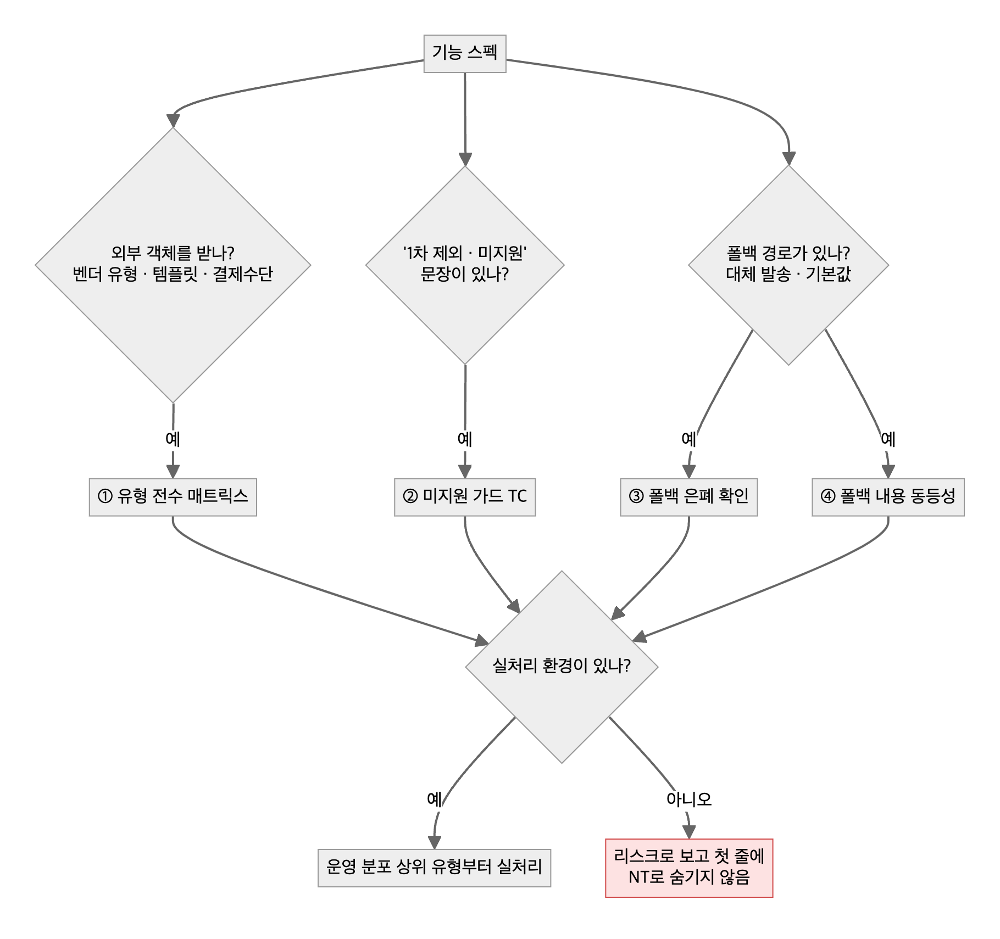

# 02. TC 설계

> 지원하는 것만 테스트하면, 미지원 입력이 들어오는 길은 아무도 막지 않는다.

## 기법 고르기

| 스펙에 이런 게 있으면 | 기법 | 예 |
|---|---|---|
| 숫자 범위·상한 | 경계값 | 0, 1, 상한-1, 상한, 상한+1 (조용히 잘리는 상한을 찾는다) |
| 조건 조합 | 결정 테이블 | 쿠폰 × 결제수단 × 회원 등급 |
| 상태가 바뀌는 흐름 | 상태 전이 | 대기 → 신청 → 결제 → 취소 → 환불 |
| 옵션이 많은 조합 | 페어와이즈 | 기기 × 브라우저 × 로그인 상태 |
| 외부 객체·폴백·미지원 문장 | **4묶음** (아래) | 메시지 템플릿 유형, 결제 수단 유형 |
| 같은 조건이 여러 화면에 | 목록·건수·엑셀 교차 | 목록 20건인데 "총 0명", 엑셀은 다른 숫자 |

## 4묶음 — 외부 객체·폴백·"1차 제외"가 있는 기능

| 묶음 | 행을 어떻게 만드나 | 놓치면 |
|---|---|---|
| ① 유형 전수 매트릭스 | 벤더 문서의 유형 enum 전체를 행으로. 지원·미지원 모두 | 한 유형으로 통과한 걸 커버리지로 착각 |
| ② 미지원 가드 | 스펙의 "지원하지 않음" 문장 하나당 1행: 고를 수 있나, 저장·발행이 막나 | 미지원 유형이 그대로 운영에 나감 |
| ③ 폴백 은폐 | 폴백이 '성공'으로 집계되나, 실제 전달 채널·폴백 비율을 따로 볼 수 있나 | 대부분 폴백인데 성공률 100% |
| ④ 폴백 내용 동등성 | 폴백 결과에 링크·버튼·이미지·변수가 빠지나, 작성 단계에서 경고하나 | 링크 없는 대체 문자 |

## 템플릿 — TC 시트 열

| 열 | 쓰는 법 |
|---|---|
| ID · 묶음 | `TC-012 · ②미지원가드` |
| 전제조건 | 환경·계정·데이터 상태. 실처리가 막혔으면 대체 환경을 여기에 |
| 절차 | 한 행에 한 동작 |
| 기대 결과 | 화면 문구·수치 그대로. "정상 동작" 금지 |
| 근거 | 스펙 문장 · 과거 결함 번호 |
| 결과 | 통과 / 실패 / 차단 / **리스크**(실처리 불가) |

## 체크리스트
- [ ] 스펙의 "지원하지 않음 / 1차 제외 / 추후" 문장마다 행이 있다
- [ ] 외부 객체는 유형 enum 전체가 행으로 있다
- [ ] 폴백이 있으면 "어느 경로로 성공했나"를 보는 행이 있다
- [ ] 실처리 못 한 행은 NT로 숨기지 않고 리스크로 보고했다
- [ ] 과거 결함을 TC에 역매핑해 커버리지를 숫자로 보였다 (예: 결제 TC 290건에 과거 이슈 101건 매핑)

근거 사례: [사례 07 — "발송 성공"의 대부분이 대체 문자였다](../2-career-flow/cases/07-fallback-masked-as-success.md) · [사례 05 — 2,000건에서 조용히 잘리는 일괄 변경](../2-career-flow/cases/05-silent-2000-cap.md)
