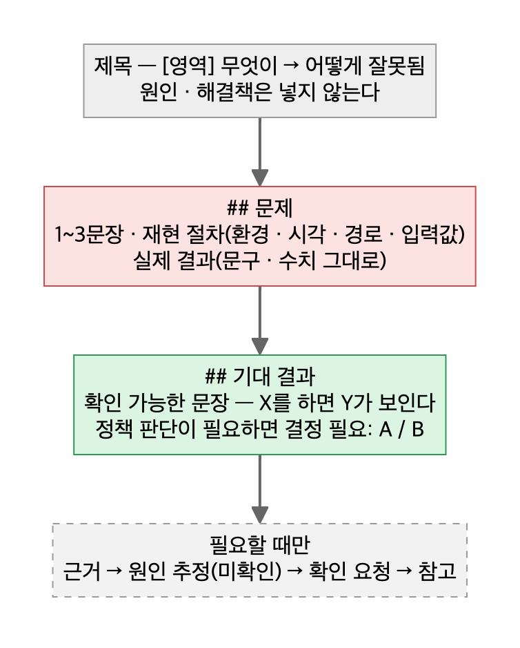

# 03. 결함 티켓

> 티켓 독자는 개발자다. **문제와 기대 결과가 분리돼 있어야 "다 고쳤다"를 판정할 수 있다.**



## 템플릿

```markdown
제목: [영역] 무엇이 → 어떻게 잘못됨

## 문제
<1~3문장. 지금 무엇이 어떻게 되나>
- 환경: <QA1 / 운영>, 시각: <YYYY-MM-DD HH:MM 시간대>
- 경로: <화면 > 메뉴 > 버튼>
- 입력: <값 그대로>
- 실제 결과: <화면 문구·수치 그대로>

## 기대 결과
<X를 하면 Y가 보인다 / 약 N명이 나온다>
결정 필요: <A안> / <B안>   ← 정책 판단이 필요할 때만

---- 아래는 필요할 때만 ----
## 근거        실측 표 · 쿼리 · 요청/응답
## 원인 추정 (미확인)
## 확인 요청    1. … 2. …
## 참고        관련 티켓 · 파일
```

## 쓰기 전 / 쓴 뒤

| 하지 않는다 | 대신 |
|---|---|
| 제목에 원인·해결책 | 제목은 증상 한 줄 |
| 추정을 문제 섹션에 사실처럼 | `원인 추정 (미확인)`으로 내린다 |
| 한 티켓에 문제 여러 개 | 티켓 분리, 묶어야 하면 표 한 행에 문제·기대 결과 나란히 |
| "정상 동작해야 함" | 확인 가능한 문장 |
| 재확인 코멘트에 경과 서술 | 첫 줄에 판정 — 통과 / 미해결 / 부분 |

## 체크리스트
- [ ] 다른 사람이 재현 절차만 보고 재현할 수 있다
- [ ] 실제 결과에 내 해석이 섞이지 않았다
- [ ] 기대 결과로 "고쳐졌다"를 판정할 수 있다
- [ ] 추정은 전부 "미확인"으로 표시했다 (콘솔 표시가 틀렸다고 주장하기 전에 결과 코드·실기기로 확인)
- [ ] 편의·표기 수준의 엣지는 티켓 대신 "관찰"로 보고했다

근거 사례: [사례 09 — 개발자가 첫 화면에서 이해하는 결함 티켓](../2-career-flow/cases/09-ticket-writing-principle.md)
