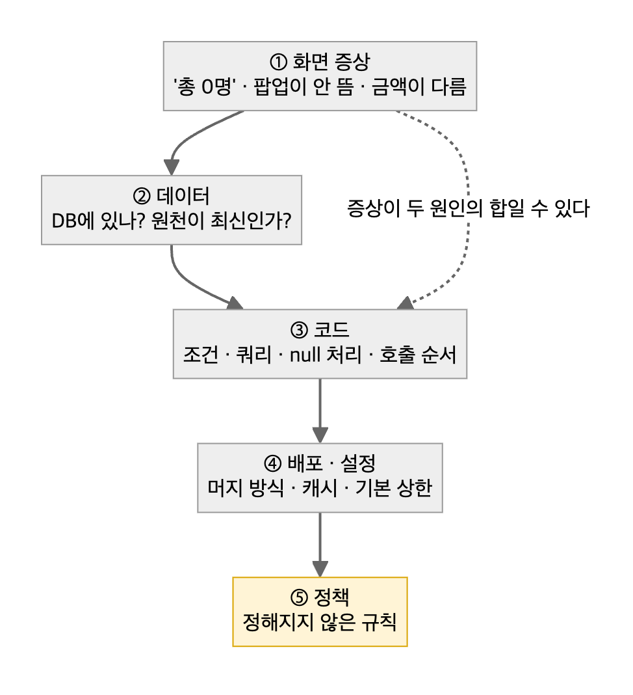

# 04. 원인 분석 보고

> 증상이 보인 곳에서 고치면 다음 달에 돌아온다. **한 층씩 내려가며 증거를 남긴다.**



| 층 | 묻는 것 | 증거 |
|---|---|---|
| ① 화면 증상 | 누가, 언제, 어떤 조건에서 보나 | 재현 영상·스크린샷, 재현 조건 |
| ② 데이터 | DB엔 있나? 원천이 최신인가? | 쿼리 원문 + 결과 + **원천의 마지막 기록 시각** |
| ③ 코드 | 어떤 조건·쿼리·null 처리가 그렇게 만드나 | 파일:줄, 바인딩된 실제 SQL |
| ④ 배포·설정 | 머지 방식·캐시·프레임워크 기본 상한 | 배포 기록, 설정값, 캐시 키 |
| ⑤ 정책 | 애초에 규칙이 정해져 있나 | 정책 문서 유무, `결정 필요: A / B` |

## 템플릿

```markdown
# <증상 한 줄>

## 재현 조건
환경 · 계정 · 데이터 상태 · 절차 · 재현율(N회 중 M회)

## 근본 원인
<층 번호> — <한 문장>
(증상이 두 원인의 합이면 원인 A / 원인 B로 나눠 각각 증거)

## 증거            [실측] / [추정·미확인] 라벨을 줄마다
- [실측] 쿼리 … → N행 (기준 시각, 데이터소스)
- [실측] 코드 path/to/file:123 — 조건 …
- [추정·미확인] …

## 영향 범위        대상 수 · 기간 · 금액, 산출 쿼리 첨부
## 조치안          즉시(운영 조치) / 근본(코드·정책) / 재발 방지(TC·모니터링)
```

## 채운 예시 — 사례 05를 템플릿에 맞춰 재구성(수치는 비율로 일반화)

```markdown
# 수강기간 일괄 연장 후 대상 일부가 기존 만료일로 남음

## 재현 조건
수강생 2,000명 초과 상품에서 일괄 연장 실행 → 100% 재현

## 근본 원인
④ 배포·설정 — API에 최대 페이지 크기 설정이 없어 프레임워크 기본 상한 2,000이 적용됐다.
③ 코드 — 프론트가 "아주 큰 페이지 크기로 한 번" 요청하고, 화면에 보인 목록만 저장 대상으로 삼았다.

## 증거
- [실측] 상품 수강생 수 > 2,000, 반영된 인원 = 2,000 (기준 시각·쿼리 첨부)
- [실측] 정렬이 최신순 → 가장 먼저 등록한 수강생이 잘림
- [실측] 서버 설정에 페이지 상한 없음 → 기본값 2,000

## 영향 범위
대상의 약 3%, 기존 만료일 그대로. 같은 패턴(한 번에 다 가져오기)을 쓰는 다른 일괄 화면 점검 필요

## 조치안
즉시: 누락 대상 보정(백엔드 배정) — 검증 "만료일별 인원" 조회가 1행·전체 인원
근본: 프론트가 상한 단위로 전 페이지 조회
재발 방지: 경계값 TC에 "기본 상한 + 1" 고정, 일괄 작업은 대상 건수 = 반영 건수로 판정
```
→ [사례 05](../2-career-flow/cases/05-silent-2000-cap.md)

## 쓰지 않을 때
- 원인이 한 줄로 확정되고 영향이 작은 결함(오타·단순 스타일)은 티켓 근거 섹션으로 충분하다.
- 장애 대응 중에는 이 형식보다 복구가 먼저다. 보고서는 복구 뒤 타임라인과 함께 쓴다.

## 체크리스트
- [ ] "0건/없음"을 판정하기 전에 데이터 원천의 최신성을 확인했다 (멈춘 복제본의 0건은 판정이 아니다)
- [ ] 1차 수정의 검증 조건이 실제 운영 조건(네트워크 지연·전송 순서·데이터량)을 흉내 냈는지 다시 봤다
- [ ] 증상이 원인 하나로 다 설명되는지 확인했다 — 남는 증상이 있으면 원인이 하나 더 있다
- [ ] 줄마다 실측/추정 라벨이 있다
- [ ] 반영 안 된 진단도 "원인 규명·미반영"으로 남겼다

근거 사례: [사례 03 — 이벤트 유실, 1차 수정 뒤집기](../2-career-flow/cases/03-event-loss-before-navigation.md) · [사례 04 — 원인 두 개가 겹친 검색 결함](../2-career-flow/cases/04-search-zero-results.md) · [사례 06 — 같은 결함이 재발한 이유](../2-career-flow/cases/06-price-snapshot-recurrence.md)
