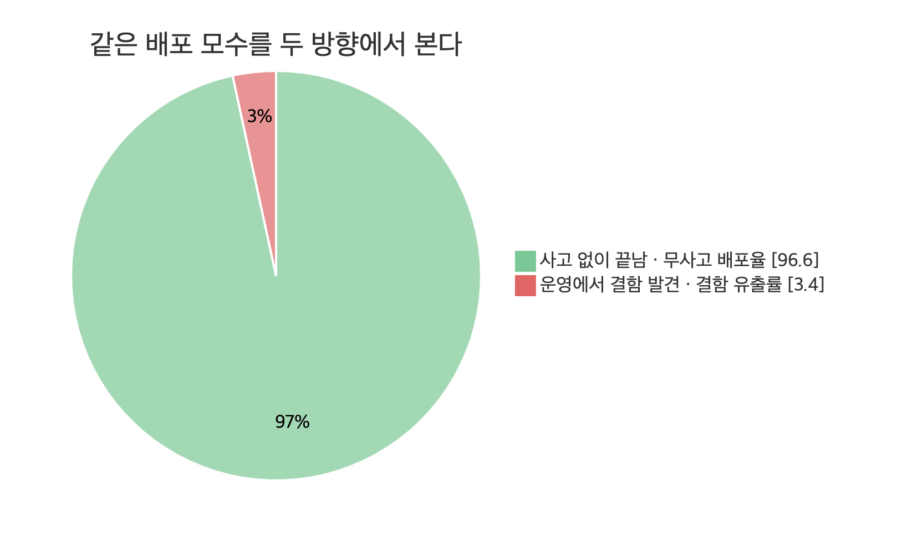
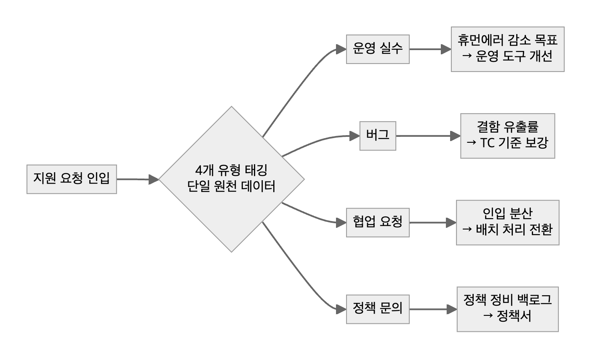

# 05. 품질 지표

> 지표는 **정의 문장 → 원천 데이터 → 측정 불가 항목 명시** 순서로 만든다. 측정할 수 없는 것을 추정치로 메우지 않는다.

결함 유출률과 무사고 배포율은 같은 모수를 두 방향에서 본 한 쌍이다. 하나는 줄일 목표, 하나는 지킬 보고 지표로 쓴다. 같은 데이터에서 나오므로 두 숫자가 서로 다른 이야기를 할 수 없다. (실측 3.40% / 96.60%, 목표 2% / 98% — 미달까지 그대로 보고)

## 원천 데이터를 하나로

구성원마다 다른 목표를 두되, 모든 지표가 같은 원천(지원 요청 4개 유형 태깅)을 보게 한다.

## 템플릿 — 지표 정의서

| 항목 | 작성 |
|---|---|
| 이름 | 결함 유출률 |
| 정의 문장 | 운영에 나간 뒤 결함이 발견된 비율 — "QA를 통과하고도 새어 나간 것" |
| 분자 / 분모 | <무엇을 1건으로 세나> / <같은 기간 같은 모수> |
| 원천 | 이슈 트래커 라벨 · 배포 기록 (조회 쿼리 링크) |
| 주기 · 기준 시각 | 월 1회, 말일 24시 기준(시간대 명시) |
| 짝 지표 | 무사고 배포율 (합 100%) |
| 목표 · 현재 | 2% · 3.40% |
| 측정 불가 | 리드타임 — 워크플로에 "QA 중" 상태가 없어 측정 불가 → 상태 추가를 개선 과제로 |

## 체크리스트
- [ ] 정의를 문장으로 먼저 썼다
- [ ] 분자·분모가 같은 원천에서 나온다
- [ ] 측정 불가 항목을 추정치 대신 "측정 불가 + 이유"로 적었다
- [ ] 팀 합계와 내 몫을 구분했다
- [ ] 목표 미달도 같은 형식으로 보고했다

근거 사례: [사례 02 — 측정 체계가 없던 곳에 품질 지표 세우기](../2-career-flow/cases/02-measuring-escape-rate.md) · [사례 01 — 백오피스 만족도 7.29 → 8.82](../2-career-flow/cases/01-backoffice-as-product.md)
