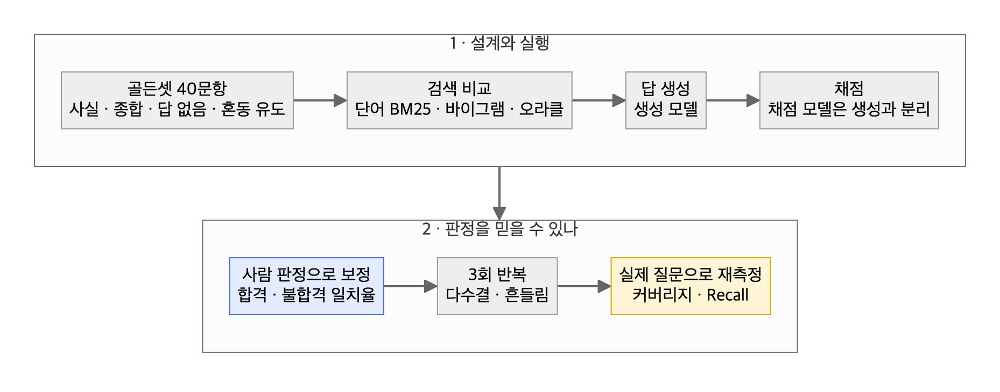
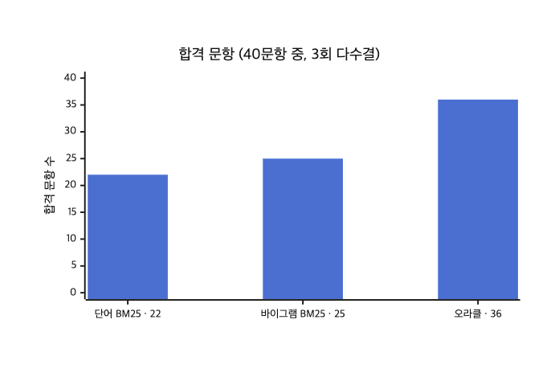

# 06. AI 결과물 평가 (RAG·챗봇)

> AI 기능은 같은 입력에도 결과가 흔들린다. **한 번 실행으로 판정하지 않고, 채점하는 AI도 사람 판정으로 검증한다.**



## 실험 결과 — 사내 문서 RAG



| 발견 | 값 | 그래서 |
|---|---|---|
| 정답 문서를 직접 주면(오라클) 36/40, 검색을 거치면 22~25/40 (3회 다수결) | 병목은 **찾는 쪽** (바이그램 vs 오라클, 정확 McNemar 검정 p=0.001) | 생성 모델보다 검색부터 고친다 |
| 단어 BM25 vs 바이그램 BM25 | 22 vs 25, 차이는 유의하지 않음(정확 McNemar 검정 p=0.51) | 작은 개선은 40문항으로 판별이 안 된다 — 표본을 늘리거나 통계로 확인 |
| 같은 설정 3회 반복 | 흔들림 5~10% (판정이 갈린 문항 비율) | 1회 실행 점수로 판정하지 않는다 |
| 파일 단위 Recall | 합격을 예측하지 못함 | 정답 **단락**이 들어왔는지로 잰다 |
| 실제 질문 160여 개의 문서 커버리지 | 21% (AI 초벌 라벨 기준) | 검색을 고치기 전에 문서가 없다 |
| Recall: 골든셋 vs 실제 질문 | 0.77 vs 0.53 | 골든셋 점수는 실사용보다 낙관적 |
| AI 채점자 vs 사람 판정 25건 | 합격 일치 0.58 → 0.83, 불합격 일치 0.92 | **같은 25건으로 기준을 다듬은 값**이라 과적합 가능성 → 목표 85% 미달 + 새 표본 미검증 → **"검증 중"**, 인용 보류 |

## 템플릿 — 골든셋 설계

| 유형 | 비율(40문항 기준) | 왜 |
|---|---|---|
| 사실 확인 | 20 | 기본기 |
| 여러 문서 종합 | 8 | 검색이 여러 조각을 모으는지 |
| 답이 없음 | 8 | 모른다고 하는지 (지어내지 않는지) |
| 혼동 유도 | 4 | 비슷한 문서에 속는지 |

정답은 "이 중 하나면 합격(any-of)"과 "모두 있어야 합격(all-of)" 그룹으로 적는다.

## 템플릿 — AI 채점자 보정

```
1. 사람이 25건 이상 직접 판정 (합격/불합격 + 이유 한 줄)
2. AI 채점자 판정과 비교 → 합격 일치율(TPR) · 불합격 일치율(TNR) 따로
3. 불일치 건을 읽고 채점 기준 문구를 고친다
4. 다시 비교 — 단, 기준을 다듬은 그 표본으로 잰 일치율은 낙관적이다
5. 판정자가 AI 판정을 보지 않은 **새 표본(불합격 사례 충분히)**으로 다시 잰다
6. 새 표본에서 둘 다 목표(예: 85%)를 넘기 전에는 AI 채점 점수를 "검증 중"으로만 쓴다
```

## 쓰지 않을 때
- 답이 하나로 정해진 기능(분류·추출)은 RAG 평가 틀이 과하다. 정답 라벨과 정확도·재현율로 충분하다.
- 골든셋을 만들 문서가 없으면 평가보다 문서 작성이 먼저다(커버리지 21%처럼).

## 체크리스트
- [ ] 생성 모델과 채점 모델을 분리했다
- [ ] 오라클(정답 문서 제공)로 상한선을 먼저 쟀다
- [ ] 3회 이상 반복해 흔들림을 쟀다
- [ ] 골든셋 외에 실제 질문으로 다시 쟀다
- [ ] 채점자 일치율은 기준을 다듬지 않은 새 표본으로 쟀다
- [ ] 채점자 일치율이 기준 미달이면 점수를 인용하지 않았다

근거: [내가 가져가는 것 — 5. RAG 평가 실험](../3-why-me/README.md#5-rag-평가-실험--ai-결과물을-재는-법)
