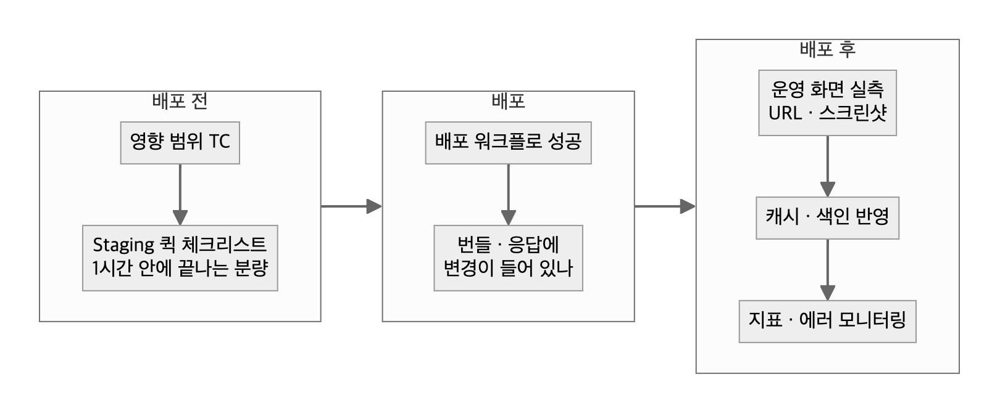

# 07. 배포 전후 확인

> "배포 성공"은 워크플로가 끝났다는 뜻이다. **완료는 대상 환경에서 변경이 보이는 것**이다.

## 템플릿 — Staging 퀵 체크리스트 (1시간 안에 끝나는 분량)

| 영역 | 확인 | 결과 |
|---|---|---|
| 로그인 · 회원 | 가입 · 로그인 · 로그아웃 | |
| 핵심 구매 경로 | 상세 → 결제 → 완료 → 내역 | |
| 결제 수단 | 카드 · 간편결제 · 쿠폰 적용 금액 | |
| 이번 변경 영역 | 변경 TC 중 P1만 | |
| 운영 도구 | 이번 변경과 연결된 관리 화면 저장 · 조회 | |

### 채운 예시 (재구성)

| 영역 | 확인 | 결과 |
|---|---|---|
| 로그인 · 회원 | 가입 · 로그인 · 로그아웃 | 통과 |
| 핵심 구매 경로 | 상세 → 결제 → 완료 → 내역 | 통과 |
| 결제 수단 | 카드 · 간편결제 · 쿠폰 적용 금액 | 통과 (쿠폰 적용 후 금액 = 결제 금액) |
| 이번 변경 영역 | 변경 TC P1 6건 | 5 통과 · 1 실패(S3, 담당자 인지) → 배포 진행, 공지에 한 줄 |
| 운영 도구 | 변경과 연결된 관리 화면 저장 · 조회 | 통과 |

## 배포 직후 확인

| 확인 | 방법 |
|---|---|
| 배포 워크플로 성공 | CI·배포 기록에서 이번 커밋 포함 여부 |
| 변경이 실제로 나갔나 | 프론트는 번들에서 바뀐 문구 검색, 백엔드는 응답 필드 확인 |
| 대상 환경에서 보이나 | 실제 도메인 URL·스크린샷 (로컬·프리뷰 아님) |
| 캐시·색인 | CDN·서버 캐시 무효화, 검색 색인 재생성 필요 여부 |
| 순서 의존 | API가 화면보다 먼저 나가야 하나 — 그 사이 구 화면 오류 가능 시간 |
| 모니터링 | 에러율 · 핵심 지표 첫 1시간 |

## 배포 진행 / 중단 판단

| 진행 | 중단(또는 범위 축소) |
|---|---|
| P1 TC 전부 통과 | P1 실패가 하나라도 있음 |
| 남은 결함은 S3 이하이고, 담당자가 알고 있음 | 결제·개인정보·데이터 유실(S1) 결함이 열려 있음 |
| 배포 순서와 그 사이 위험이 적혀 있음 | API와 화면 배포 순서가 정해지지 않았는데 둘 다 바뀜 |
| 롤백 방법이 정해져 있음 | DB 변경이 있는데 되돌리는 방법이 없음 |

판단은 QA가 근거를 내고, 배포 결정은 담당 PO·리드가 한다. "진행"이어도 남은 위험은 배포 공지에 한 줄로 남긴다.

## 롤백 기준

| 상황 | 기준 |
|---|---|
| 결제·접속 장애 | 원인 파악보다 **롤백이 먼저** |
| 에러율 급증 | 배포 직후 평소의 2배 이상이 10분 넘게 지속되면 롤백 검토 (시작값 — 팀의 평소 변동폭에 맞춰 조정) |
| DB 변경 포함 | 코드 롤백만으로 안 되는지 사전에 확인. 안 되면 배포 전에 되돌림 스크립트 준비 |
| 캐시·색인 | 롤백 후에도 남는 캐시·색인이 있는지 확인(롤백했는데 화면이 그대로인 경우) |

## 쓰지 않을 때
- 문구 한 줄·이미지 교체처럼 영향 범위가 화면 하나인 배포에는 퀵 체크리스트 전체가 과하다. 변경 화면 실측 + 캐시 확인만 한다.

## 체크리스트
- [ ] 퀵 체크리스트가 1시간 안에 끝난다 (넘으면 P1만 남긴다)
- [ ] 완료 보고에 확인한 URL을 남겼다
- [ ] 캐시·색인 반영을 따로 확인했다
- [ ] 여러 레포가 같이 나가면 배포 순서와 그 사이 위험을 적었다
- [ ] 운영 첫 실사용(첫 저장·첫 발송)을 확인할 사람·시점을 정했다

근거: [사례 04 — 운영 반영 후 다른 열로 동작 실측](../2-career-flow/cases/04-search-zero-results.md) · [사례 05 — 대상 건수 = 반영 건수로 판정](../2-career-flow/cases/05-silent-2000-cap.md)
