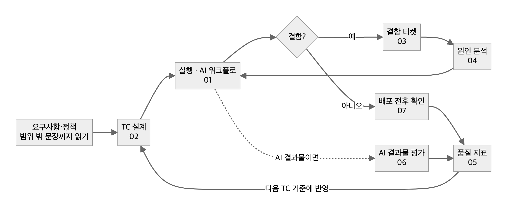

# 4. QA 플레이북 — 지금 쓰는 템플릿

> 2023년에 만든 QA 템플릿을 3년 동안 실제로 쓰고 고친 결과로 다시 썼다. 문서 양식보다 **판단 순서**를 담았다.
> 각 문서는 그림(흐름이 있는 문서) → 복사해서 쓰는 템플릿과 채운 예시 → 쓰지 않을 때 → 체크리스트 → 이 규칙이 생긴 사례 순서다.

| # | 문서 | 언제 쓰나 | 핵심 한 줄 |
|---|---|---|---|
| 01 | [AI 에이전트 QA 워크플로](01-ai-qa-workflow.md) | 티켓을 받았을 때 | 기준 한 줄 → 원인 → 수정 → 독립 검증 → 대상 환경 실측 |
| 02 | [TC 설계](02-tc-design.md) | 스펙을 받았을 때 | 외부 객체·폴백·"미지원" 문장이 있으면 4묶음 필수 |
| 03 | [결함 티켓](03-defect-ticket.md) | 결함을 찾았을 때 | 맨 위는 `문제`와 `기대 결과` 두 섹션 고정 |
| 04 | [원인 분석 보고](04-root-cause-analysis.md) | 원인을 찾아야 할 때 | 증상 → 데이터 → 코드 → 배포·설정 → 정책 순으로 내려간다 |
| 05 | [품질 지표](05-quality-metrics.md) | 팀 품질을 숫자로 볼 때 | 정의 문장 → 원천 데이터 → 측정 불가 명시 |
| 06 | [AI 결과물 평가](06-ai-output-evaluation.md) | 챗봇·RAG·AI 기능을 검증할 때 | 한 번 실행으로 판정하지 않고, 채점자도 검증한다 |
| 07 | [배포 전후 확인](07-release-check.md) | 배포할 때 | "배포 성공"이 아니라 "대상 환경에서 보인다"가 완료 |
| 08 | [성능·부하 테스트](08-performance-test.md) | 트래픽이 몰리는 시즌 전 | 목표 수치를 먼저 정하고, 운영과 같은 요청 비율로 민다 |

그림 원본은 [img/src/](img/src/)의 Mermaid 파일이다. 고친 뒤 `node tools/render_diagrams.mjs`로 다시 그린다.
