# 5. 발표 자료 — 15분 포트폴리오 발표

> 이 레포의 내용을 면접 발표 순서로 16장에 담았다. 장마다 근거 문서를 연결했고, 숫자는 모두 원자료로 다시 확인한 값이다.

- 넘겨 보기: [portfolio-deck.html](portfolio-deck.html)을 내려받아 브라우저로 연다. ←/→ 또는 클릭으로 넘기고, `N`을 누르면 발표 대본이 보인다.
- 아래는 같은 슬라이드의 이미지다.

## 흐름

| 단계 | 장 | 근거 문서 |
|---|---|---|
| 1 누구이고 5년 동안 무엇을 했나 | 1~3 | [이력서](../이력서.md) · [경력기술서](../2-career-flow/경력기술서.md) |
| 2 운영 도구와 품질을 숫자로 | 4~5 | [사례 01](../2-career-flow/cases/01-backoffice-as-product.md) · [사례 02](../2-career-flow/cases/02-measuring-escape-rate.md) |
| 3 원인을 찾아 고치고 운영 문의를 닫는다 | 6~8 | [사례 03](../2-career-flow/cases/03-event-loss-before-navigation.md) · [04](../2-career-flow/cases/04-search-zero-results.md) · [05](../2-career-flow/cases/05-silent-2000-cap.md) · [07](../2-career-flow/cases/07-fallback-masked-as-success.md) · [09](../2-career-flow/cases/09-ticket-writing-principle.md) |
| 4 AI를 업무 시스템으로 | 9~10 | [사례 08](../2-career-flow/cases/08-ai-agent-qa-workflow.md) · [이식 가이드](../1-ai-workflow-guide/README.md) |
| 5 AI가 만든 결과가 맞는지 잰다 | 11~13 | [내가 가져가는 것 5절](../3-why-me/README.md#5-ai-결과물을-재는-법) · [사례 10](../2-career-flow/cases/10-rag-evaluation.md) · [사례 11](../2-career-flow/cases/11-ontology-review.md) |
| 6 숫자를 다루는 원칙과 합류 후 90일 | 14~16 | [내가 가져가는 것](../3-why-me/README.md) |

---

## 1. 누구이고 5년 동안 무엇을 했나

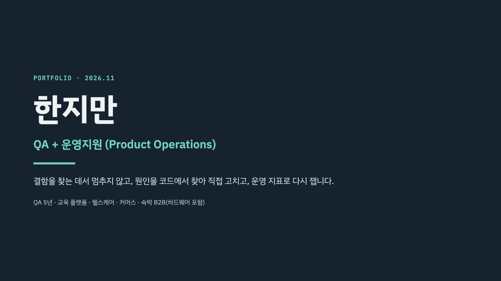

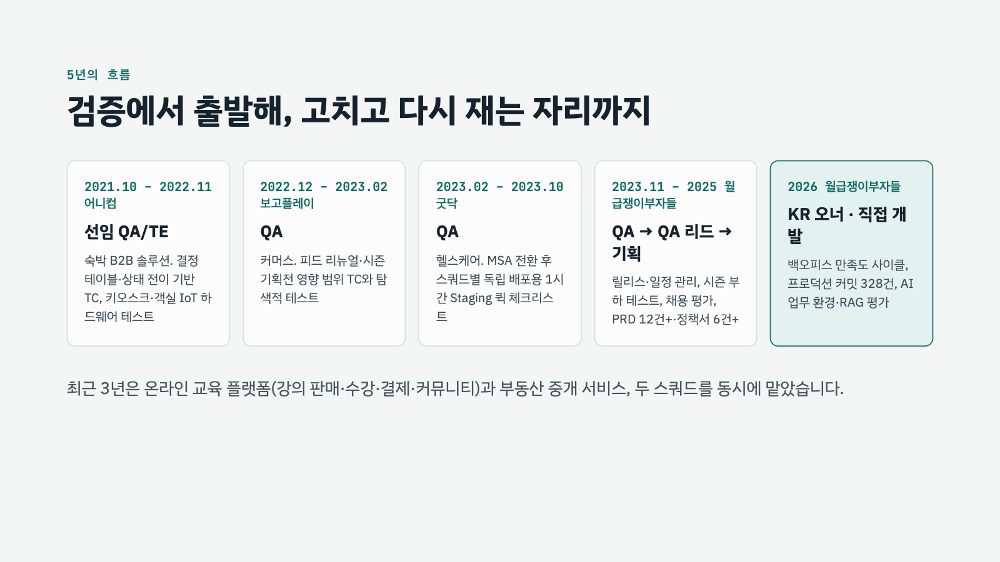

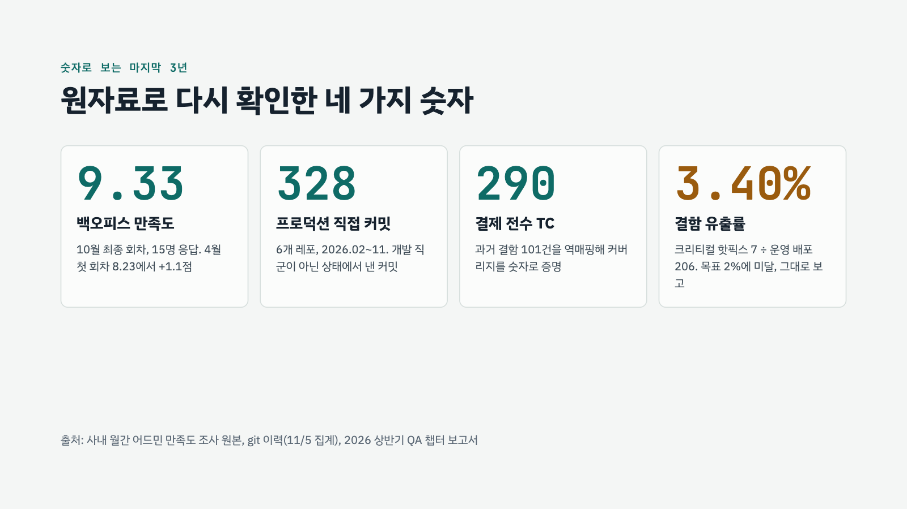

## 2. 운영 도구와 품질을 숫자로

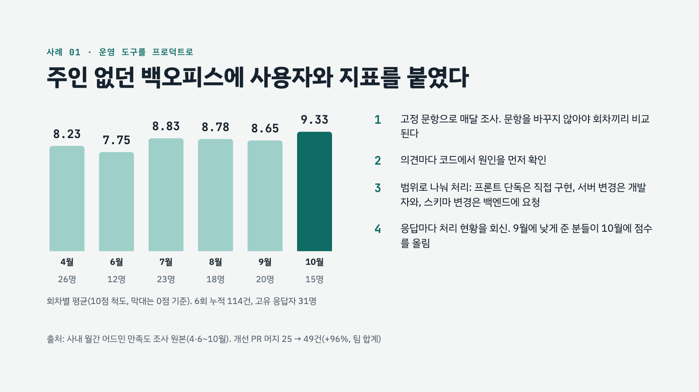

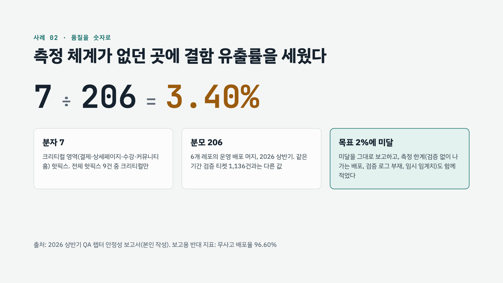

## 3. 원인을 찾아 고치고 운영 문의를 닫는다

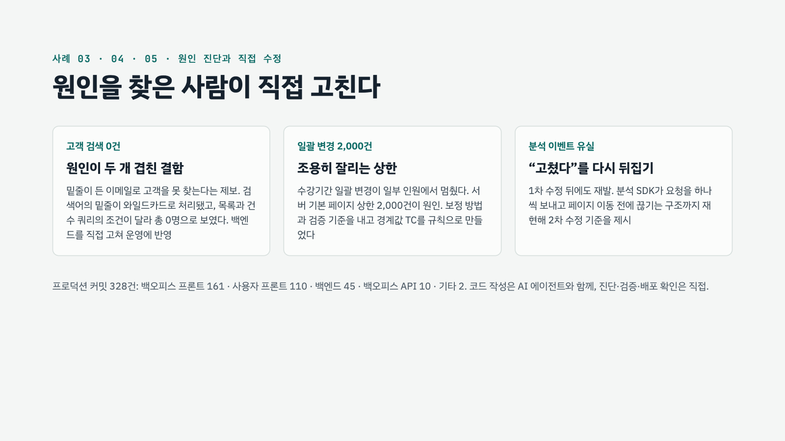

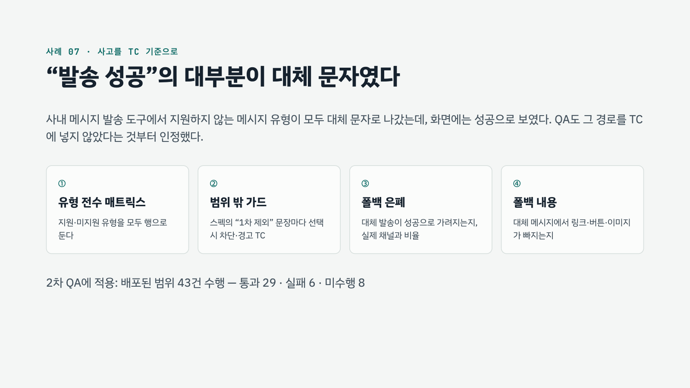

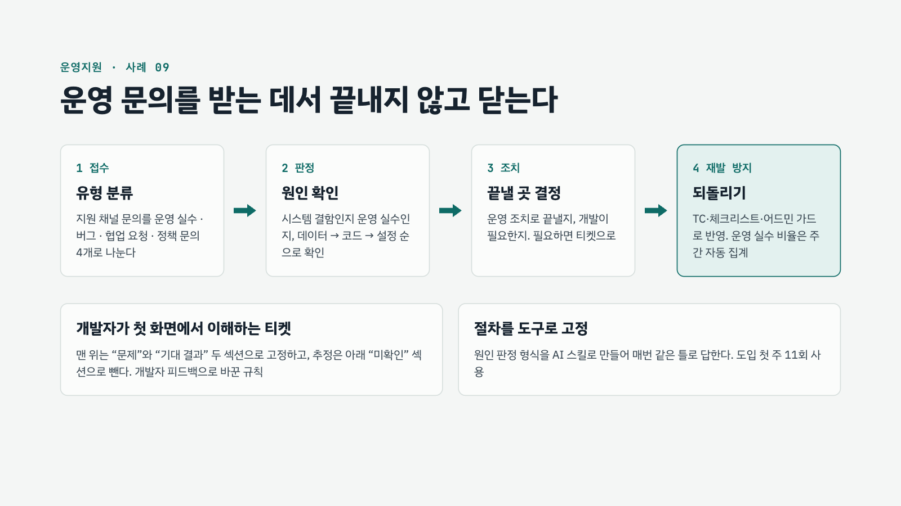

## 4. AI를 업무 시스템으로

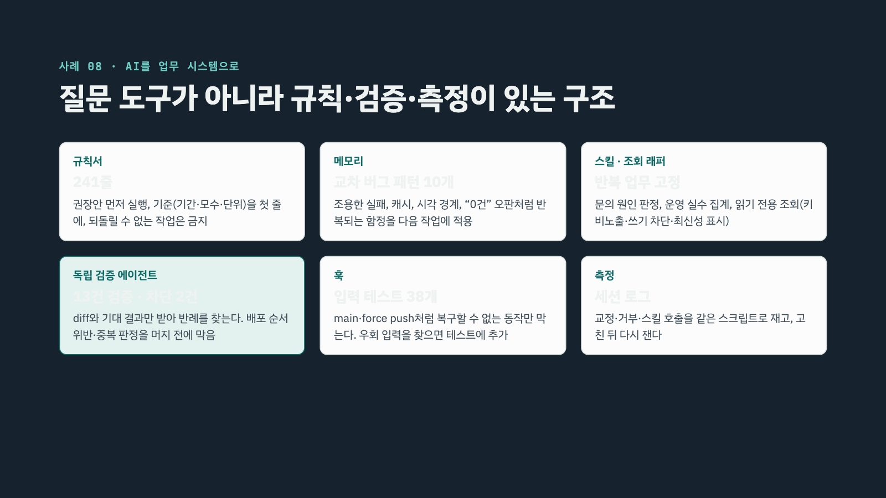

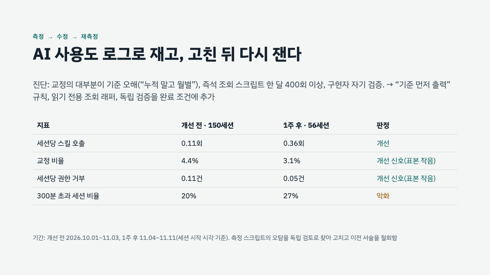

## 5. AI가 만든 결과가 맞는지 잰다

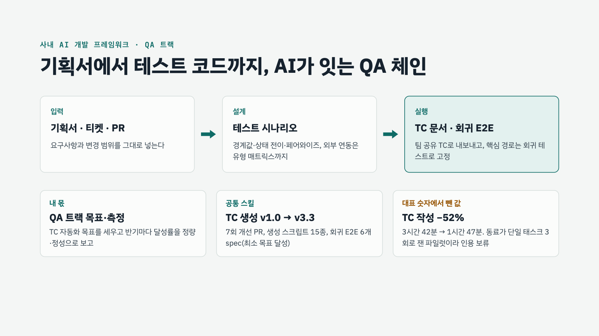

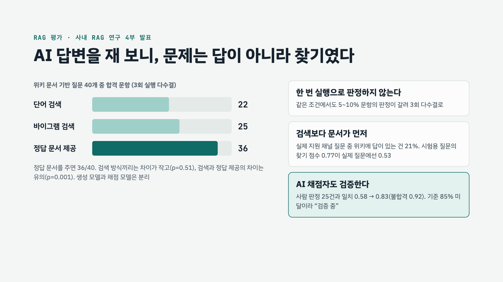

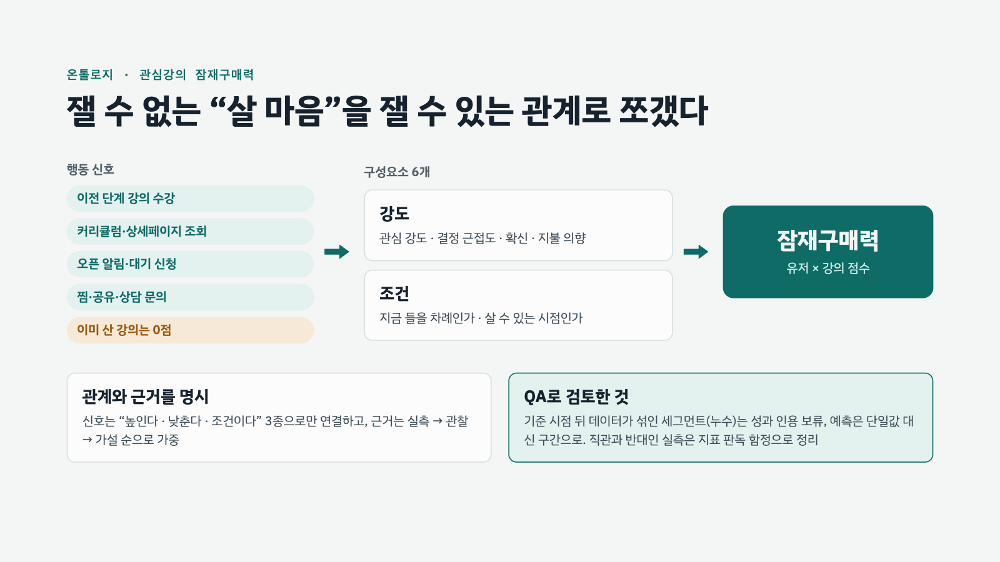

## 6. 원칙과 합류 후 90일

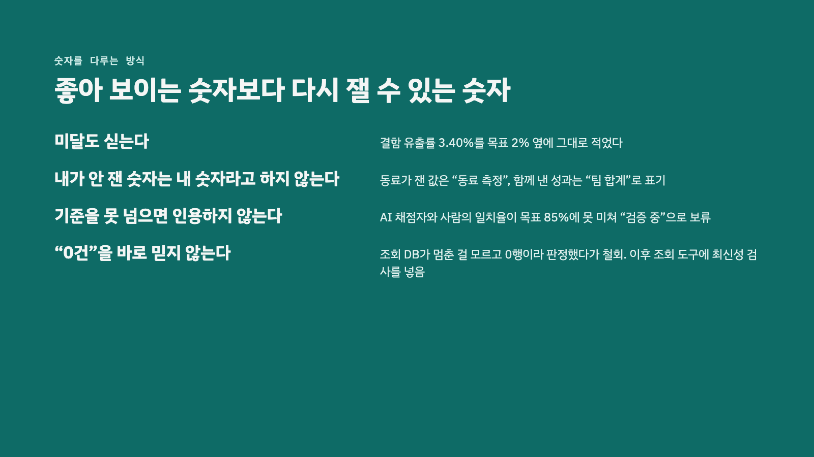

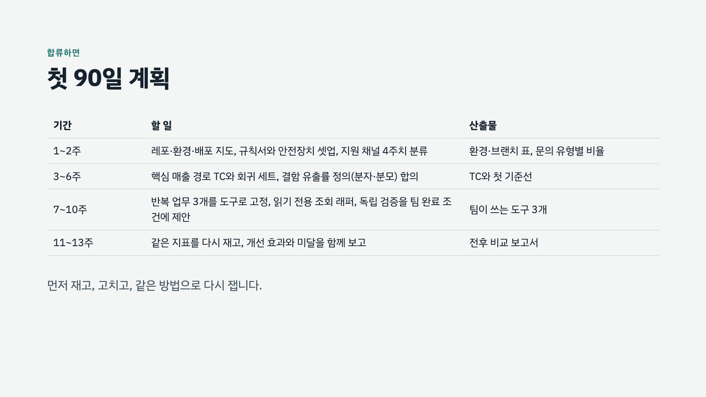

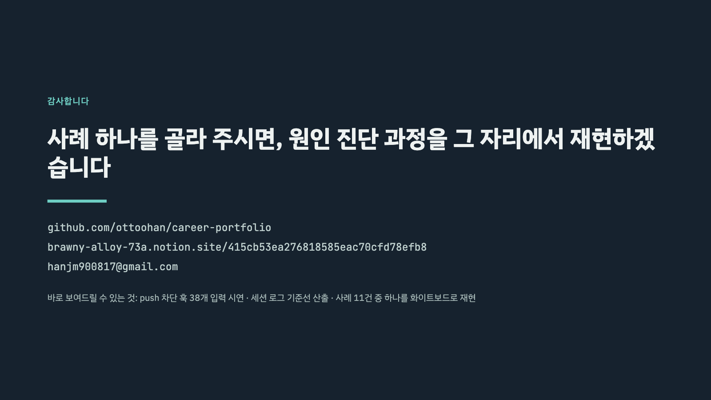
