# 5. 발표 자료 — 15분 포트폴리오 발표

> 이 레포의 내용을 면접 발표 순서로 본편 15장 + 부록 1장에 담았다. 장마다 근거 문서를 연결했고, 숫자는 모두 원자료로 다시 확인한 값이다.

- 넘겨 보기: [portfolio-deck.html](portfolio-deck.html)을 내려받아 브라우저로 연다. ←/→ 또는 클릭으로 넘기고, `N`을 누르면 발표 대본이 보인다.
- 아래는 같은 슬라이드의 이미지다.
- 고치려면 [src/](src/)의 슬라이드 원본을 수정하고 `python3 tools/build_deck.py 5-presentation/src 5-presentation/portfolio-deck.html`로 다시 만든다.

## 흐름

| 단계 | 장 | 근거 문서 |
|---|---|---|
| 1 누구이고 무엇을 했나, 대표 숫자 | 1~3 | [이력서](../이력서.md) · [경력기술서](../2-career-flow/경력기술서.md) |
| 2 운영지원과 운영 도구 | 4~5 | [경력기술서 0절](../2-career-flow/경력기술서.md#0-운영지원--운영-문의를-판정하고-닫기) · [사례 12](../2-career-flow/cases/12-ops-inquiry-triage.md) · [사례 01](../2-career-flow/cases/01-backoffice-as-product.md) |
| 3 품질과 원인 진단 | 6~8 | [사례 02](../2-career-flow/cases/02-measuring-escape-rate.md) · [13](../2-career-flow/cases/13-promotion-price-crosscheck.md) · [03](../2-career-flow/cases/03-event-loss-before-navigation.md) · [04](../2-career-flow/cases/04-search-zero-results.md) · [05](../2-career-flow/cases/05-silent-2000-cap.md) · [07](../2-career-flow/cases/07-fallback-masked-as-success.md) |
| 4 AI를 업무 시스템으로, AI 결과물 평가 | 9~12 | [사례 08](../2-career-flow/cases/08-ai-agent-qa-workflow.md) · [사례 10](../2-career-flow/cases/10-rag-evaluation.md) · [AI 부록](../3-why-me/ai-appendix.md) |
| 5 숫자를 다루는 원칙과 합류 후 90일 | 13~15 | [내가 가져가는 것](../3-why-me/README.md) |
| 부록 질문 대비 | 16 | [사례 11 온톨로지 검토](../2-career-flow/cases/11-ontology-review.md) |

---

## 1. 누구이고 무엇을 했나

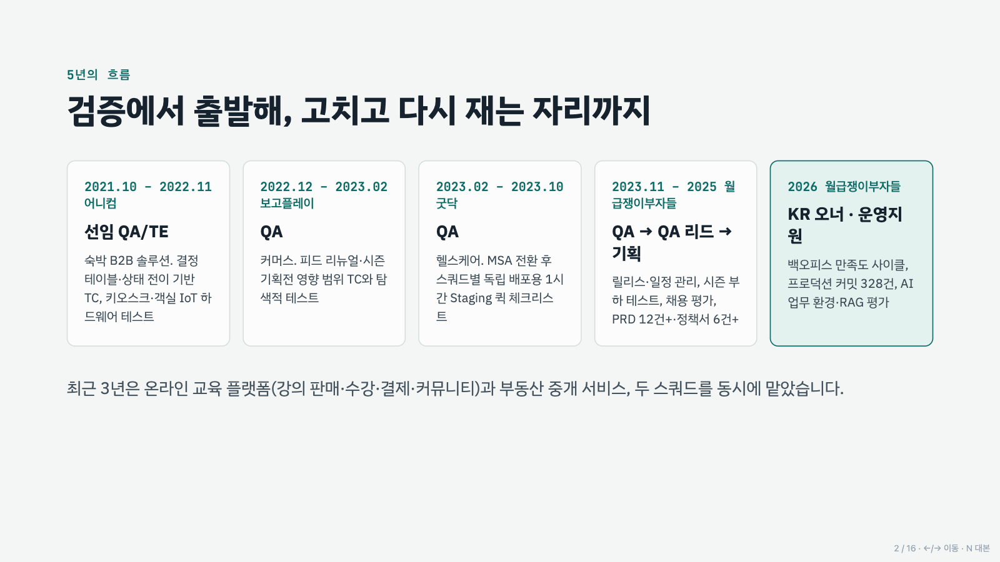

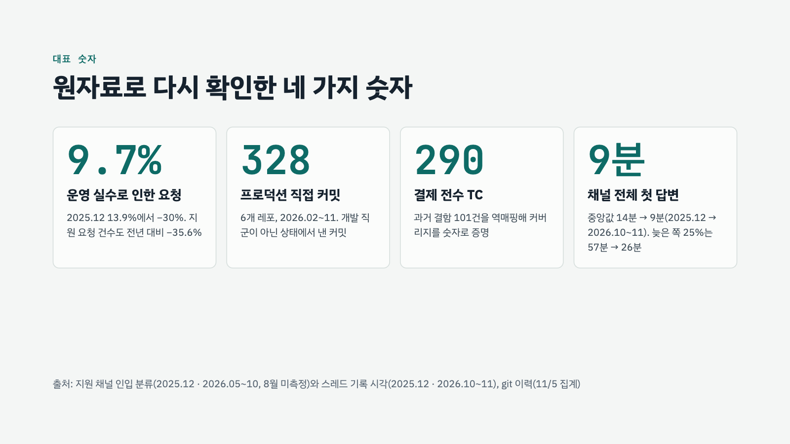

## 2. 운영지원과 운영 도구

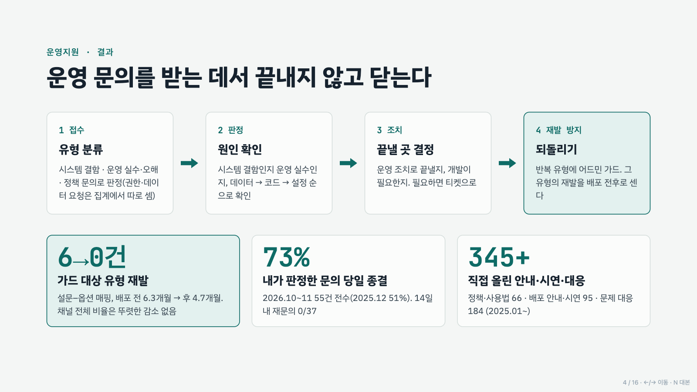

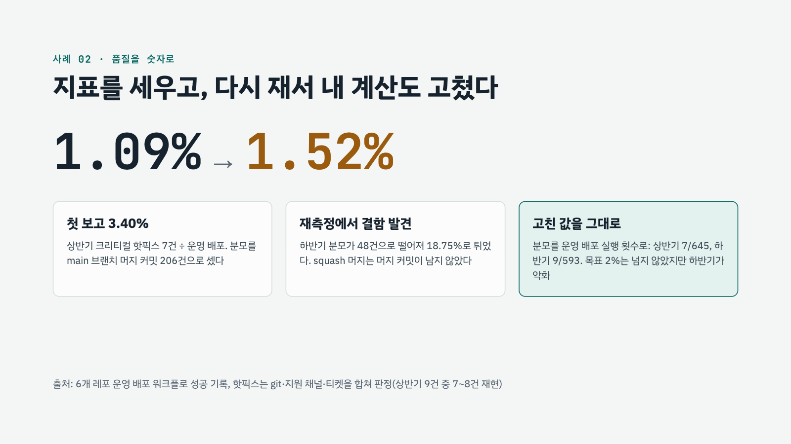

## 3. 품질과 원인 진단

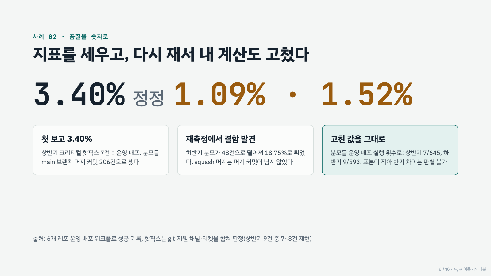

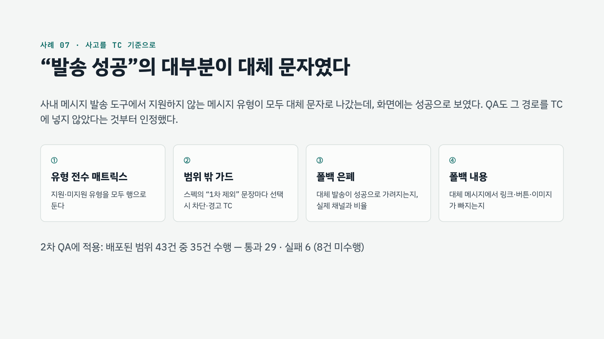

## 4. AI를 업무 시스템으로, AI 결과물 평가

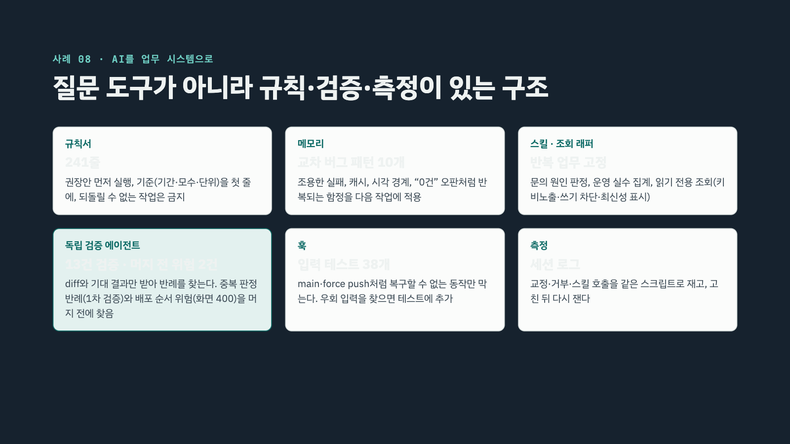

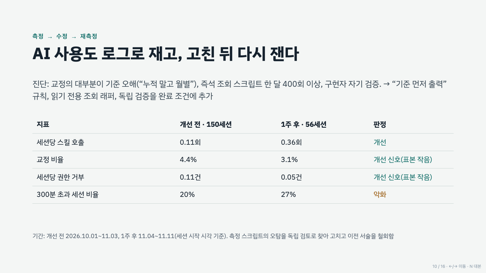

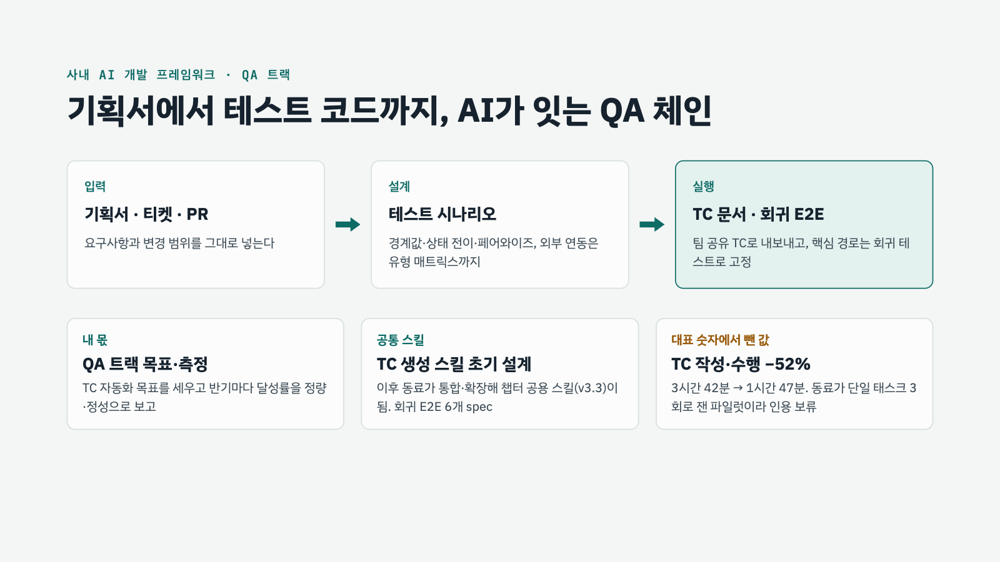

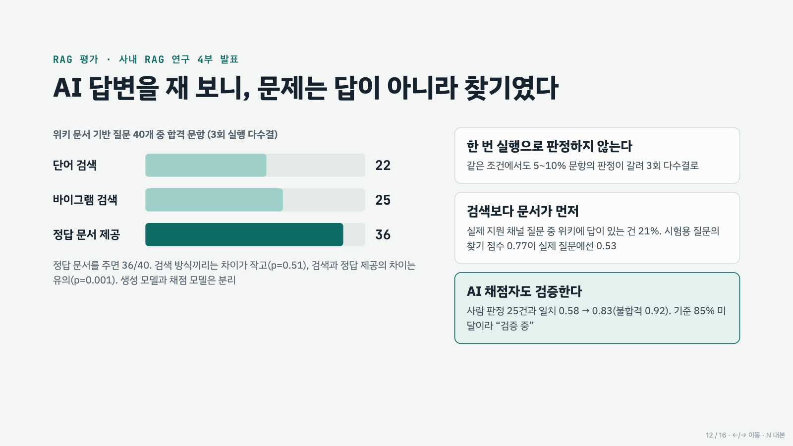

## 5. 원칙과 합류 후 90일

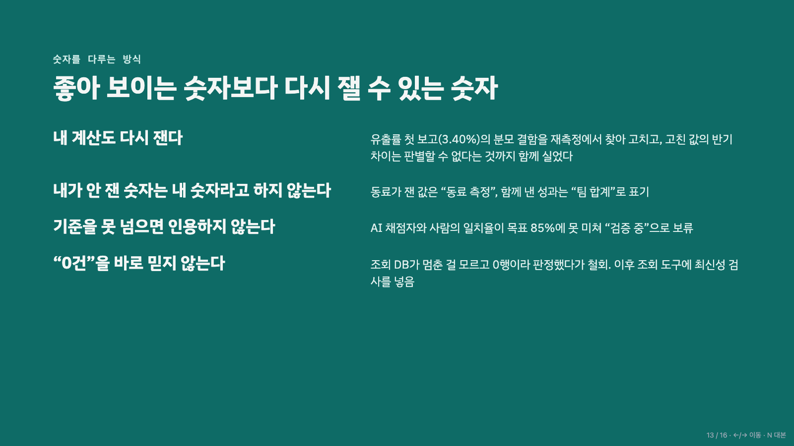

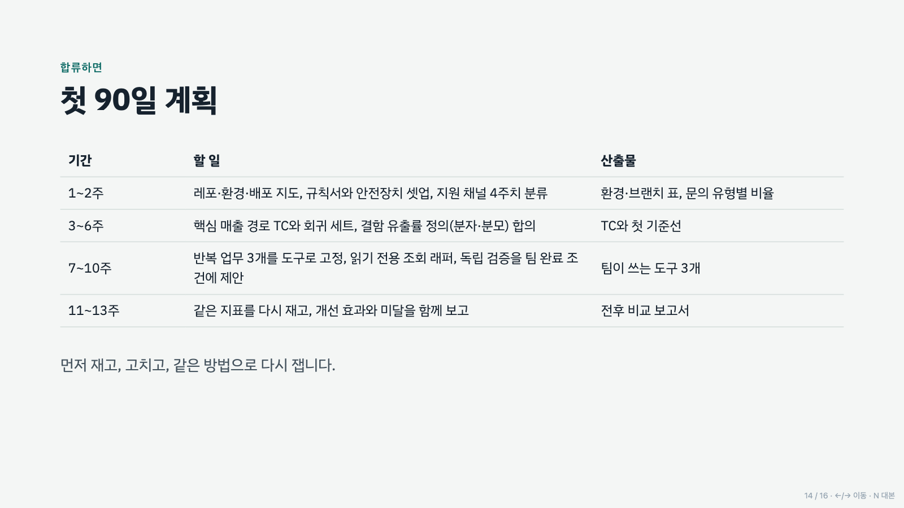

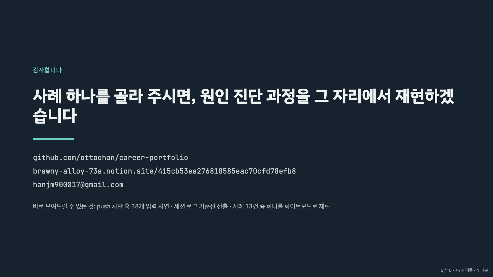

## 부록 — 질문이 나오면

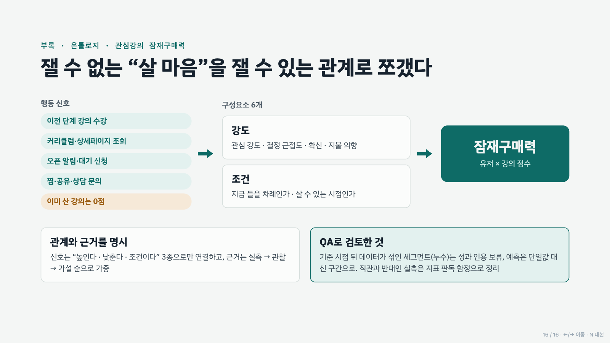
